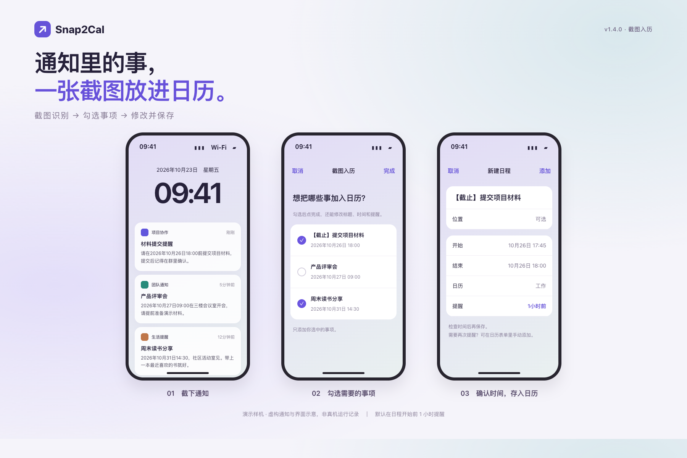

# Snap2Cal · 截图入历

**截图里的通知，勾一勾就能放进 iPhone 日历。**

不用在聊天记录和日历之间来回复制。把通知截下来，交给快捷指令识别，再挑选需要的事项，确认标题和时间后保存。



> 上图是使用虚构通知制作的演示样机，便于说明流程，并非真机运行截图。实际界面随 iOS 版本和日历账户有所不同。

## 下载与安装

**[下载 Snap2Cal v1.4.0 快捷指令](dist/Snap2Cal-v1.4.0.shortcut?raw=true)**

在 iPhone 上打开文件，点「添加快捷指令」，按提示完成配置。如果浏览器显示文件预览，可先保存到「文件」，再打开安装。

第一次安装需要填写或选择：

| 设置 | 如何选择 |
| --- | --- |
| API Key | 填写自己的 DeepSeek API Key；留空则每次运行时询问。网页版会员与 API 服务不是同一个入口。 |
| 模型 | 默认 `deepseek-flash`。换模型时请确认支持图片输入。 |
| 日程时长 | 默认 15 分钟。通知里说 18:00，创建的日程就是 17:45—18:00。 |
| 保存日历 | 选择自己的「工作」「个人」等可写入日历。 |
| 提醒 | **默认在日程开始前 1 小时提醒**，也可以在安装时改成其他选项。 |

首次运行时，按系统提示允许截图、读取图片、联网和添加日历等所需权限。需要联网和可用的 DeepSeek API 账户；不需要安装其他脚本应用。

## 怎么用

### 截完图，直接分享

1. 截图后打开截图预览，点「分享」。
2. 选择已安装的 Snap2Cal 快捷指令；分享列表里没看到时，先到「更多」中查找。
3. 勾选想添加的事项，点「完成」。
4. 在随后打开的日历表单里修改标题、开始/结束时间和提醒，确认后保存。

一张图里有几条通知，就会尽量分别识别。**未勾选的事项不会添加**；选中的事项会逐条打开保存表单。

### 双击背面，截取当前屏幕

进入 iPhone「设置 → 辅助功能 → 触控 → 轻点背面 → 轻点两下」，选择这个快捷指令。支持该功能的 iPhone 可在查看通知时双击背面启动；没有分享图片输入时，快捷指令会尝试截取当前屏幕。

为了提高识别成功率，先展开通知，让标题和时间完整显示，再运行。

## 提醒和时间怎么算

默认日程区间是「通知提到的时刻往前 15 分钟，到该时刻结束」。提醒以**日程开始时间**为基准。

例如通知写「10 月 26 日 18:00 前提交材料」：

| 项目 | 默认结果 |
| --- | --- |
| 标题 | 【截止】提交材料 |
| 日程开始 | 10 月 26 日 17:45 |
| 日程结束 | 10 月 26 日 18:00 |
| 提醒 | 10 月 26 日 16:45，即日程开始前 1 小时 |

保存前可以改任何字段。改完结束时间后，也请检查开始时间，日历表单不保证自动保留 15 分钟间隔。

没识别到明确时间时，清单会显示「待补充」，保存页的标题会带有 **【时间待确认】**。此时日期只是临时填入的当前时间，**请先改成正确时间，再点添加**。

### 以后怎么修改默认提醒

1. 在「快捷指令」App 中，点这个快捷指令卡片的「…」。
2. 滑到接近底部，找到「添加新日程」（英文界面是 `Add … from … to …`）。
3. 点动作内日期旁的**蓝色圆圈箭头 `〉`**，展开更多设置。
4. 修改「提醒 / Alert」；同一处也可以修改保存的日历。

下面的「显示提醒 / Show alert」只是错误提示框，不是日历提醒设置。

只想改一条日程时，直接在运行时的日历表单里改即可。需要两次提醒，可以在支持的日历表单里手动添加「第二次提醒」；当前快捷指令只预填第一次提醒。

## 试一试

仓库提供三张**虚构通知测试图**，可以保存到 iPhone 后，从分享菜单运行：

| 测试图 | 重点观察 |
| --- | --- |
| [三条独立通知](tests/fixtures/01-multiple-notices.png) | 三条的标题、时间、地点分别对应；只选第一和第三条时，应只打开这两条表单。 |
| [有一条没写时间](tests/fixtures/02-missing-time.png) | 不应把另一条通知的会议时间套过来；没写时间的事项应由你补充。 |
| [跨年、闰日与错误日期](tests/fixtures/03-calendar-boundaries.png) | 保留明确年份；错误日期不得作为确定时间直接使用，应人工核对。 |

这些图片不是识别准确率或通知送达的测试证据。模型输出有随机性，请始终检查保存页。

## 你的数据会去哪里

截图和本次识别到的文字，会发送到 **DeepSeek 官方接口 `api.deepseek.com`**，用于提取日程。不要使用包含你不愿上传内容的截图。

每次请求独立发送，不附带之前的对话、日程或手动修改记录。本项目没有额外的服务器和统计服务；第三方服务自身的数据处理政策仍适用。

API Key 保存在你自己配置的快捷指令中。分享给朋友时，发送本仓库里的**空密钥原版**，不要导出已经填写了个人密钥的副本。不要在 Issue 中贴出密钥或含私人内容的截图。

## 已知限制

- 需要联网；没有离线识别或自动重试。
- 每次只处理分享内容中的第一张图片，多张图片请分别运行。
- 模型可能漏掉事项、理解错日期，保存前必须核对。仅有日期、没有具体时刻时，需要手动补充。
- 同一截图重复运行可能重复创建日程，当前没有自动去重。
- 多条事项逐条保存，中途取消不会撤回已经保存的日程。
- 提醒已经过了触发时间时不会补发；通知送达还受系统权限、专注模式和日历账户影响。
- 网络异常、权限拒绝或模型返回格式错误时，可能出现系统错误提示。
- 没有标明年份的月日按当前年份理解，过去日期不会自动顺延一年；跨年通知请特别核对。

## 开发与验证

核心构建和检查使用 Python 3 标准库，不需要安装 Python 第三方包：

```sh
python3 tools/build_shortcut.py
python3 tools/validate_shortcut.py
python3 tools/check_event_flow.py
```

在安装了快捷指令工具的 Mac 上签名，才能分发安装文件：

```sh
shortcuts sign --mode anyone \
  --input dist/Snap2Cal.unsigned.shortcut \
  --output dist/Snap2Cal-v1.4.0.shortcut
```

- `tools/build_shortcut.py`：原生动作与模型提示，构建时不嵌入个人配置。
- `tools/validate_shortcut.py`：结构、引用、配置项和请求编码检查。
- `tools/check_event_flow.py`：使用固定模型结果模拟最终创建流程，**不代替 iPhone 真机测试**。
- `tools/build_demo.cjs`：演示样机与虚构测试图的可复现生成脚本；需要 Playwright 和本地 Chrome。
- [发布说明](CHANGELOG.md) / [验证范围](docs/TESTING.md)。

使用中遇到问题，可以开 Issue，描述 iOS 版本、触发步骤和实际提示。截图前请遮住密钥与私人信息。

## 参考

流程灵感来自 [Add to Calendar 快捷指令](https://www.icloud.com/shortcuts/77505cb6f9854801a5cfd77ab8781b2f)。本仓库提供当前实现的构建工具，没有分发参考快捷指令原件。

图片输入能力与模型配置以 [DeepSeek 官方文档](https://api-docs.deepseek.com/zh-cn/guides/vision/)为准。
